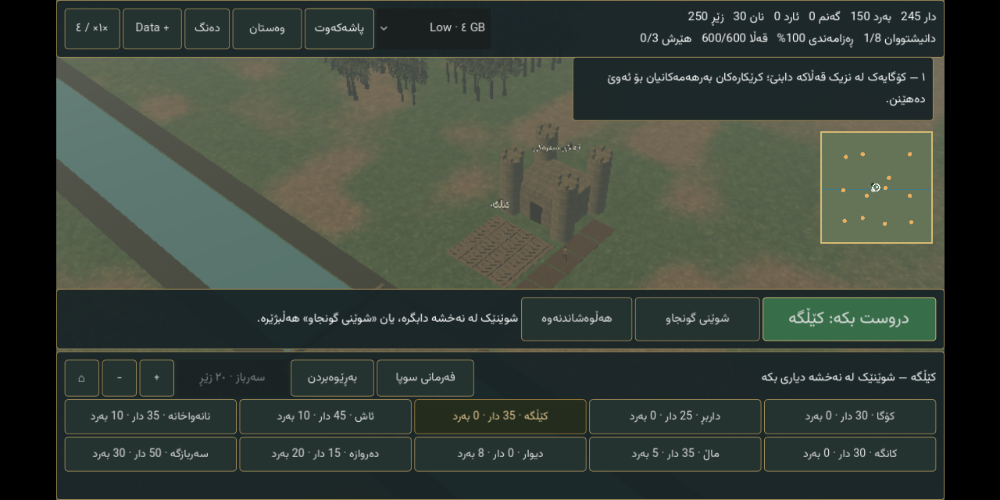

# Iron Crowns 0.11 — Godot realm expansion

**Published and verified.** Engine, native Android and complete terrain-data verification passed. The exact reviewed artifacts were attached by [publisher 39379687005](https://github.com/s1po0/iron-crowns/actions/runs/39379687005); all three desktop map renders plus the Android opening/gameplay images were visually reviewed before publication.

## What actually changed

- Three **400 × 400 cell** realms, each **1.2 × 1.2 km** at 3 m/cell. The old maps were 40 × 40: **10× each dimension, 100× area**, not 100× each dimension.
- Legacy Valley/Crossing/Ridge maps remain available to old schema 1–3 saves. World coordinates retain their old origin; loading a different map resets navigation correctly. The new Android package does not automatically read other apps' private saves.
- **625 terrain chunks** per realm. Nearby 16 × 16-cell chunks load nearest-first, at most one upload per frame; chunks outside the 5 × 5 neighborhood unload. Minimap terrain is cached; building changes update their navigation footprints rather than resetting 160,000 terrain cells.
- **12 trading/supply posts and 36 village houses**, streamed with the terrain. Houses block navigation/construction. Bring three living soldiers within six cells of a post to claim a one-time reward: 120 wood, 80 stone, 60 gold, 20 bread. Captured posts turn green on the minimap and their claims persist in saves. Win by surviving all three raids **and claiming three posts**.
- **1× / 4× simulation speed**, revised woodland distribution, existing construction, physical worker deliveries, wheat/flour/bread chain, gates, repairs, demolition, morale and army commands retained.
- Native Android **multi-file region import**, processed serially rather than loading a multi-gigabyte archive into memory. One-file desktop import is also supported.

## Downloads and installation

- [Foundation APK and base Data](https://github.com/s1po0/iron-crowns/releases/tag/v0.11.0-castle-realms)
- [All 25 terrain regions](https://github.com/s1po0/iron-crowns/releases/tag/v0.11.0-realm-data)
- [Exact official region checksums](REALM_SHA256SUMS.txt), [catalog](realm-data-manifest.json), [full decoded-image verification](REALM_DATA_VERIFIED.txt)

1. Keep older apps installed if you need their saves. Install **Iron-Crowns-0.11.0-Castle-Realms.apk**, package `com.ironcrowns.castles.realms` (version code 12). This is a separate app, with CI debug signing; not a production-signed in-place upgrade.
2. At first launch, import **Iron-Crowns-0.11.0-Castle-Data.icdata**. The API-1 base art is approximately 20 MB; the compatible 0.9.1/0.10 base Data also works. **Do not select an `.icregion` at this initial base-Data prompt.**
3. Download the region files. Start with **Realm-Region-2-2.icregion**, covering the starting settlements in all three realms.
4. In the game, press **Data +**. Choose the downloaded `.icregion` files in Android's document picker (long-press for multiple selection where supported; maximum 25). Keep the app open while copying/verifying. It processes each file separately and stops on a bad file, preserving already installed regions.
5. When installation finishes, press **بەردەوام بە** to resume. You can install the remaining regions later. Missing regions use coarse fallback terrain; they do not block movement or construction. Download **all 25** for the complete detailed world.
6. Start with **Low** on 4 GB devices. Low uploads 512 px terrain textures; Medium/High use 1024 px. These are settings/targets, **not certified device requirements or measured physical-phone FPS**.

**Storage:** allow around **6 GB free** while retaining the downloads and their installed copies. The complete terrain download alone is **2,201,556,826 bytes** (2.20 GB / 2.05 GiB), plus base Data and the APK. You may delete the original `.icregion` downloads after successful installation; installed data is app-private and will be removed if you uninstall the app. Keep downloadable backups if necessary.

### ڕێنمایی کورت

- APKی **0.11 / Castle Realms** دابمەزرێنە؛ ئەپی کۆن مەسڕەوە ئەگەر پاشەکەوتەکەت پێویستە.
- سەرەتا فایلی **.icdata** بهێنە؛ پاشان لە یاری **Data +** دابگرە و فایلەکانی **.icregion** هەڵبژێرە.
- **Realm-Region-2-2** ناوچەی دەستپێکە. هەموو ٢٥ فایلەکە بۆ زەویی وردی تەواوی نەخشەکە پێویستن.
- دوای دامەزراندن **بەردەوام بە** دابگرە. بۆ بنیاتنان: **کێڵگە ← شوێنی گونجاو ← دروست بکە**.
- خاڵە پرتەقاڵییەکان پۆستی بازرگانین؛ سێ سەرباز بۆ نزیکیان بنێرە. بۆ سەرکەوتن سێ پۆست بگرە و سێ هێرش تێپەڕێنە.

## What the 2.20 GB contains (and does not contain)

**1,250 distinct 1024 × 1024 RGB PNGs:** one original terrain albedo and one tangent-space normal map for each of the 625 chunks. They contain grass/soil/pebble color variation and height-derived surface normals. Each has a specific world/chunk address actually consumed by `RealmTerrain`; there is no padding, repeated dummy payload or hidden executable content. The three realm layouts share this terrain library. Village/building/person assets remain in the much smaller, separately licensed base Data.

This is **primarily a terrain texture library**, not 2 GB of new characters, buildings, quests, animations or photogrammetry. File size is not a measure of artistic quality. The generator uses seeded procedural fields, and floating-point/image encoding differences across platforms can change individual bytes; use the **official released checksums**, not hashes from an independent local rebuild.

The assets are generated by `scripts/build-realm-data.py` (NumPy 2.2.6 / Pillow 11.2.1). Large outputs live outside Git, under ignored `build/`. `scripts/verify-realm-data.py` independently reads every container, checks every payload SHA-256, fully decodes every PNG, verifies coordinates/dimensions/uniqueness and rejects missing or extra payloads.

API 2 is separate from the unchanged API-1 base content format. The importer limits regions to 96 MiB, requires exactly 50 whitelisted PNG filenames, checks hashes and 1024² RGB headers before image decoding, writes in 64 KiB blocks with frame yields, stages the region and activates it only after validation. Existing installed regions are retained on validation failure; previous directories can recover an interrupted replacement. Hashes detect corruption; a pack's internal manifest alone is not an authenticated publisher signature.

## Verification and honest limits

- Data generation/upload: [39377124846](https://github.com/s1po0/iron-crowns/actions/runs/39377124846), generator source `34cf63fd1380bfab3411f0eeb697837030c019af`.
- Independent **download of the actual release + decoding all 1,250 images**: [39378293443](https://github.com/s1po0/iron-crowns/actions/runs/39378293443), passed. Every official container digest was also matched against GitHub's asset metadata.
- Initial expanded engine/maps/touch/render/Android-farm run: [39377006724](https://github.com/s1po0/iron-crowns/actions/runs/39377006724), passed. Subsequent native region testing exposed an Android `ls` column-format assumption in the test, not a failed import; the test was corrected to count filenames.
- Final APK build [39378897264](https://github.com/s1po0/iron-crowns/actions/runs/39378897264), source `40f51fc122adef4537314c06aaa9e670c1f49265`, **passed** (7m56s). The smoke test imports the **actual central region** through Android SAF, checks 50 installed files, builds a farm through touch and verifies map-aware save/restart. It does not import all 25 files on the emulator or benchmark a physical phone.

**Not complete:** commercial-quality art/animation, siege engines, a full strategic/diplomatic campaign, native Supabase/cloud saves, production signing, cross-package save transfer, physical 4/6/8 GB benchmarks. Some existing engine shutdown diagnostics report cached resources at exit; these are not evidence of a measured long-session memory profile. This remains a playable RTS prototype, not a finished Stronghold replacement.

Dropbox's connected account has a 2 GiB quota, smaller than the complete new library; the full Data is distributed on GitHub instead. The old Dropbox base-Data mirror remains untouched. Unrelated email/task/database connections were not accessed or modified.

The completed **Unreal source-only prototype is preserved** in `unreal/`, but Godot is the active engine again.

## Exact APK artifact

- `Iron-Crowns-0.11.0-Castle-Realms.apk`: **174,733,911 bytes**.
- SHA-256: `8831fa68ff55c49f6d8e13ecdc96c7330be9d9b15b840a3d9202c6245c436236`.
- Base Data: **20,083,426 bytes**, SHA-256 `74c6b041c8ac1e60450db2413df484e1abe4d998430e1de08978bea870900386` (byte-identical to the previous compatible base library).
- Both releases are public: 9 APK/base/review assets and 27 regional-data/catalog/checksum assets. The large generated textures are not stored in Git.

