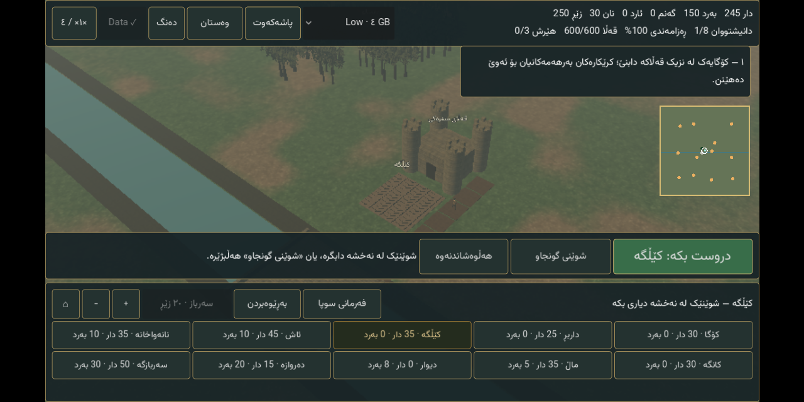

# 0.12 — one complete Data file

**Published and verified.** The producer, Godot tests and actual Android tests passed. [Publisher 39382290113](https://github.com/s1po0/iron-crowns/actions/runs/39382290113) attached the exact tested files; the Android opening and gameplay screenshots were visually reviewed before publication.

The user's request is to put **all terrain regions inside Data**, not require 25 separate region imports. Version 0.12 implements a single API-3 `.icdata` containing:

- The 56 existing base-art/audio/model/catalog files.
- All **1,250 terrain images**, covering every one of the **625 chunks / 25 regions**.
- Per-file sizes and SHA-256 hashes in one bounded manifest.

The terrain is encoded as **lossless WebP**, retaining the original 1024×1024 resolution and exact RGB pixels. The builder decodes and compares every result against its official 0.11 PNG before packaging it. This avoids exceeding GitHub's per-file limit without throwing away regions, reducing resolution, or adding padding. It is a single Data file, not a ZIP containing files the player still needs to import individually.

## Installation

1. [Download and install the 0.12 APK](https://github.com/s1po0/iron-crowns/releases/download/v0.12.0-castle-complete/Iron-Crowns-0.12.0-Castle-Complete.apk).
2. [Download the single Complete Data](https://github.com/s1po0/iron-crowns/releases/download/v0.12.0-castle-complete/Iron-Crowns-0.12.0-Complete-Data.icdata). This is the only content download needed.
3. Launch **Iron Crowns: Castle Complete**, press **هێنانی داتا**, and select that one file.
4. Keep the app open until verification finishes. **Data ✓** means the complete terrain library is installed. No `.icregion` selection or separate base-Data download is needed.

Allow roughly **6 GB free for a fresh installation**, including the download, the native picker's temporary copy, and staged installed files. The temporary copy is deleted afterwards. Existing complete installations can require more working space during replacement; previous data is kept until the new pack is verified and activated. Source downloads are never deleted automatically.

**New APK required:** 0.11 cannot understand the new container/file table. The separate package is `com.ironcrowns.castles.complete`, version code 13. Keep the older app installed if you need its saves; saves do not transfer automatically across packages. The 0.11 releases remain untouched.

## Safety and compatibility

- API 1 base Data remains supported, with its original 256 MiB payload budget and legacy regional imports. The complete pack uses **API 3 / ICDATA03**, not an incompatible change disguised as API 1.
- Complete containers are bounded below 2 GiB, manifest headers at 512 KiB, and individual payloads at 16 MiB. The native URI copy uses a 64 KiB buffer; the whole Data is never allocated in RAM.
- Every terrain filename must match a specific chunk/type; all 1,250 are mandatory. Traversal/duplicate/unexpected terrain paths are rejected.
- Lossless WebP dimensions are checked before decoding, then hashes and decoded dimensions are verified. A temporary directory is activated only after complete validation. Failed imports keep the previous active pointer/data; obsolete base/complete directories are removed only after successful replacement.
- Terrain still streams into bounded nearby chunks. Combining files does not load the entire world into GPU memory.

## Verification record

- Producer source: `8e08fc4` / workflow run **39380346126**. This fetches the official 0.11 regions, checks their container hashes, and checks pixel equality for every re-encoded image.
- Verified APK source: `255477b` / workflow run **39380822249**.
- **Passed:** complete pack installation and corner/central terrain lookups in Godot, malformed manifest/header rejection, and Android SAF import of the actual full-size Data followed by all 1,250-file checks, farm construction, save and restart. APK run duration: 13m32s, including waiting for the producer.

Packaging changes only: this is not a new art-quality/quest/siege expansion. Physical-device performance, native cloud saves, production signing and automatic cross-package save transfer remain unverified/unimplemented as previously documented.

## Complete Data artifact

- `Iron-Crowns-0.12.0-Complete-Data.icdata`: **1,691,433,345 bytes** (1.69 GB / 1.58 GiB).
- SHA-256: `0d8c7f769036c441c6474e6eb5900ab8569e20a791659e52c985003c65cbb629`.
- **1,306 payloads:** 56 base files + all 1,250 terrain images. No separate base `.icdata` or `.icregion` files are needed.
- The smaller size than 0.11 is from lossless encoding, not omitted terrain or reduced resolution.

APK: **174,738,430 bytes**, SHA-256 `ba03e5ca2681fb79ffc4c670806407b4613dbe7ffb9ebac12eea914ebea97229`.

