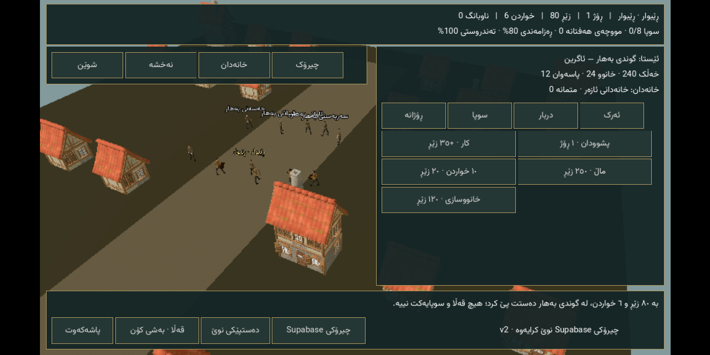
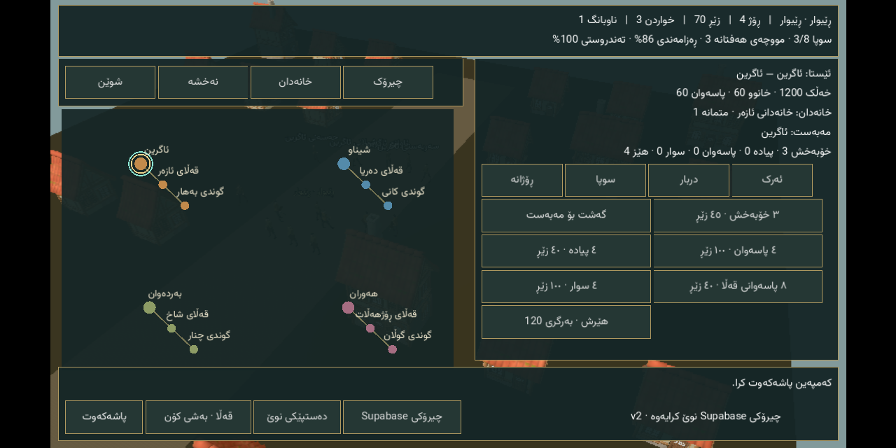

# Crown Campaign — Godot 0.13 Android preview

This is an additive Godot campaign, not a completed Warband clone. The published
0.12 APK and complete Data remain unchanged. The new campaign reuses that Data;
its new executable systems require a new APK, not a Data-only update.

## Implemented source

- Four empires, twelve settlements, sixteen adult royal-house members and named
  inhabitants. A local ordinary-person start: 80 gold, six food, no army or house.
- Work, provisions, courier/escort/relief contracts, recruitment and training,
  wages, hunger, morale, property income, allegiance and earned governorship.
- Map travel, periodic border wars/raids, castle capture and garrison reinforcement.
  Battles are explicitly **strategic autoresolution**, not player-controlled combat.
- A walkable 3D settlement representation with reused licensed village models,
  animated inhabitants, faction-colored guards and up to six party representatives.
  Rendered buildings/people are capped for mobile; population is simulated, not
  thousands of simultaneously rendered NPCs.
- Separate atomic local campaign save, validation, corrupt-save write lock and
  confirmed new-game backup. Existing castle RTS remains separately accessible.
- Eight curated Sorani story chapters from a public, read-only Supabase table;
  packaged offline story and validated monotonic cache. No player names, saves or
  private account information are uploaded. Only a publishable client key ships.

## Verification

`Crown campaign validation` compiles with Godot 4.4.1 and tests organic progression,
contracts, saves, invalid data, battles, the live public HTTPS story, actual UI
input and avatar movement. It captures an offline scene for visual review. Passing
syntax parsing alone is not a gameplay verification.

**Published:** [release](https://github.com/s1po0/iron-crowns/releases/tag/v0.13.0-crown-campaign).
Exact runtime source: `0aaff251fd429180b1caeee1991a34ab2def2e75`.
[Native build 39388145001](https://github.com/s1po0/iron-crowns/actions/runs/39388145001)
passed the full-size Data import, all 1,250 terrain files, campaign work/recruitment/
travel/save/restart and the retained RTS farm-construction/save/restart test.
[Attachment job 39389502778](https://github.com/s1po0/iron-crowns/actions/runs/39389502778)
attached that exact APK without rebuilding. Android screenshots were inspected;
they show the starting civilian, three recruited troops after travel, Supabase v2
and the completed RTS farm. Emulator verification is not physical-phone certification.

## Install and play

1. [Download APK](https://github.com/s1po0/iron-crowns/releases/download/v0.13.0-crown-campaign/Iron-Crowns-0.13.0-Crown-Campaign.apk)
   — 174,784,488 bytes, SHA-256
   `78ffee266a5ae2f24abddc8e1968c7ad0e6b2494f18b7d5364beca6493ccf434`.
2. Reuse your existing **0.12 Complete Data**, or
   [download the same single file](https://github.com/s1po0/iron-crowns/releases/download/v0.12.0-complete-data/Iron-Crowns-0.12.0-Complete-Data.icdata).
   It is 1,691,433,345 bytes, SHA-256
   `0d8c7f769036c441c6474e6eb5900ab8569e20a791659e52c985003c65cbb629`.
3. Open the new application and select that `.icdata` through its import button.
   Allow approximately **6 GB free** during import. No per-region downloads.
4. Start with work and food in **ڕۆژانە**. Recruit in **سوپا**; accept contracts in
   **ئەرک**; select a settlement in **نەخشە**, travel, then deliver the contract.
   The **خانەدان** view lists royal families; **دربار** holds court actions.
5. A mercenary rank requires 8 renown. An oath at a capital needs 25 renown and
   10 standing. A vassal needs an oath, home, 45 renown and three contracts.
   Governorship needs 80 renown, five contracts and 35 standing: petition at your
   empire's capital, provided its original castle is still friendly.
6. **قەڵا · بەشی کۆن** opens the preserved RTS. Its **کەمپەین** button returns.

Package `com.ironcrowns.crowncampaign`, version code 14. Keep older apps installed;
private saves do not automatically transfer between packages. This is preview/debug
signing, not a stable production update channel. Saves are local; the Supabase story
connection is optional and does not synchronize your campaign.

Not implemented: player-driven melee/riding, fully interactive royal NPC dialogue,
marriage/inheritance, unrestricted diplomacy, or physical-device performance
certification. The underlying original RTS, older modes and public releases are
preserved.
